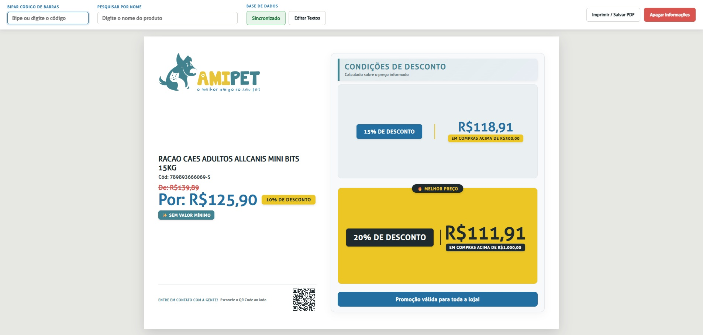
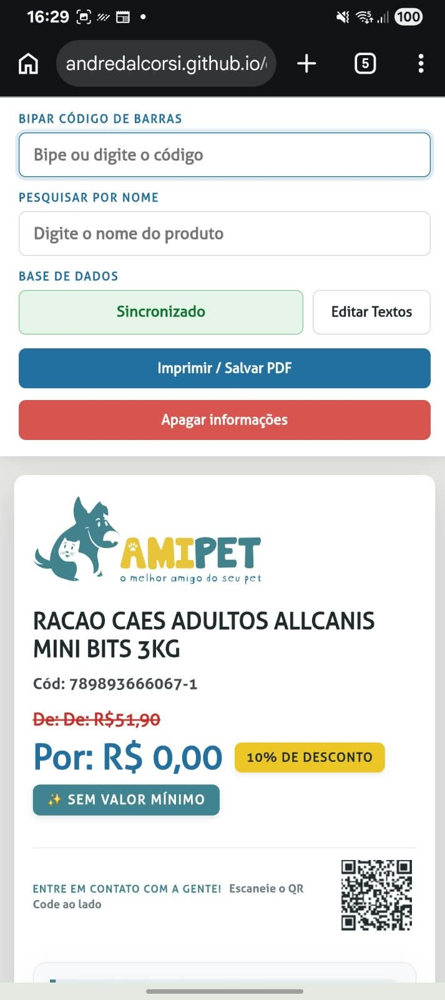
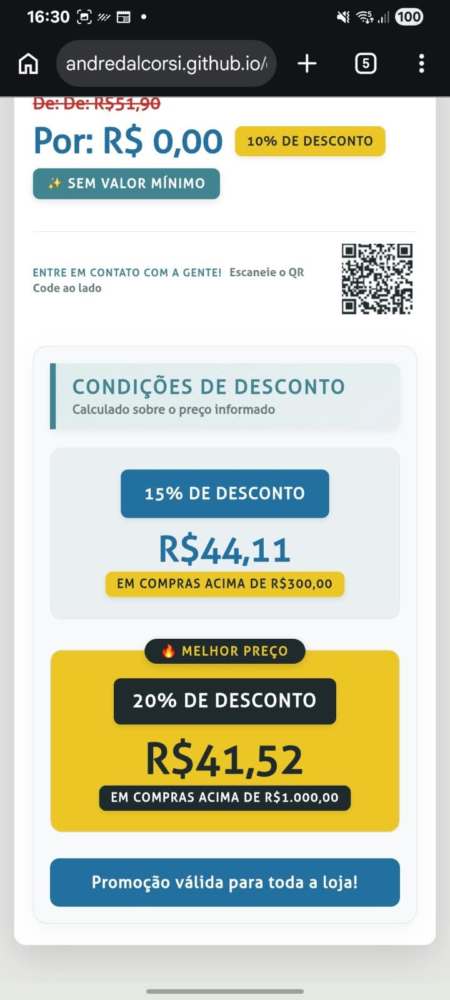

# 🐾 Cupom Amipet

Uma página web responsiva desenvolvida para divulgar, gerar ou facilitar o resgate de cupons de desconto exclusivos da **Amipet**. 

🔗 **Acesse o projeto online:** [andredalcorsi.github.io/cupom-amipet](https://andredalcorsi.github.io/cupom-amipet)

---

## ✨ Funcionalidades

- [x] Interface intuitiva e amigável para Desktop e Mobile;
- [x] Inserção prática do código de barras dos produtos via leitor de código de barras ou por inserção de texto;
- [x] Exibição clara das regras da promoção;
- [x] Botão para editar nome do produto; 
- [x] Botão para limpar informações que estão na tela; 
- [x] LocalStorage() para manter suas informações salvas;
- [x] QRCode com redirecionamento para o linktr.ee da empresa; 
- [x] Botão de impressão ou salvar em PDF disponível no topo da página.

---

## 📸 Demonstração

### Web:

  

### Mobile:

  
  &nbsp;&nbsp;
  

---

## 🛠️ Tecnologias Utilizadas

O projeto foi desenvolvido utilizando as seguintes tecnologias:

- **HTML5** — Estruturação semântica da página
- **CSS3** — Estilização, layout responsivo (Flexbox/Grid) e animações
- **JavaScript** — Interatividade (ex: botão de copiar cupom, validações)
- **GitHub Pages** — Hospedagem gratuita e deploy contínuo

---